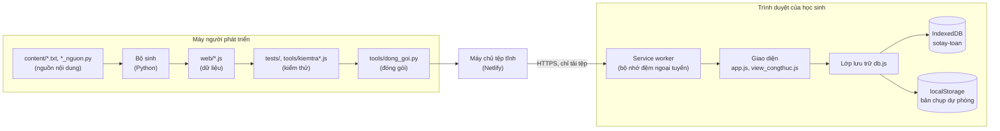
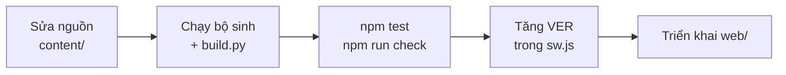

# Kiến trúc hệ thống

Sổ tay học Toán là một ứng dụng web **chạy hoàn toàn trên máy người dùng** (local-first). Không có máy chủ ứng dụng, không có tài khoản, không có cơ sở dữ liệu trên mạng. Máy chủ chỉ làm một việc: phát các tệp tĩnh trong thư mục `web/`.

## Vì sao chọn kiến trúc này

| Yêu cầu của đề tài | Hệ quả thiết kế |
|---|---|
| Học sinh dưới 18 tuổi, đề tài cam kết không thu thập họ tên | Không có máy chủ nhận dữ liệu; tiến độ học nằm trong trình duyệt của học sinh |
| Nhiều học sinh chỉ có điện thoại, mạng chập chờn | Ứng dụng cài được (PWA), service worker lưu sẵn mọi tệp để dùng khi mất mạng |
| Chi phí vận hành bằng 0 | Web tĩnh, đặt trên gói miễn phí của Netlify hoặc GitHub Pages |
| Nội dung do nhóm tự soạn, cần kiểm tra được | Nội dung là dữ liệu có cấu trúc, sinh từ nguồn văn bản và mã Python, có bộ kiểm thử |

Nếu sau này cần đồng bộ giữa các máy hoặc để giáo viên xem tiến độ lớp, xem mục [Hướng mở rộng](#hướng-mở-rộng).

## Các thành phần

### Thư mục

| Thư mục | Vai trò |
|---|---|
| `web/` | Ứng dụng. Đưa nguyên thư mục này lên máy chủ là chạy được. |
| `content/` | Nguồn nội dung: lời giải dạng văn bản (`*.txt`) và các bộ sinh bài tập, hình vẽ (`*_nguon.py`). |
| `tools/` | Công cụ dòng lệnh: kiểm tra nội dung, đóng gói bản phát hành, vẽ biểu tượng. |
| `tests/` | Kiểm thử tự động (Node, không cần thư viện ngoài). |
| `docs/` | Tài liệu thiết kế. |

### Các tệp trong `web/`

| Tệp | Nội dung |
|---|---|
| `WebApp_So_tay_hoc_Toan.html` | Khung trang: thanh điều hướng, vùng hiển thị, danh sách tệp cần nạp, chính sách CSP. |
| `app.css` | Toàn bộ kiểu dáng, có giao diện sáng và tối. |
| `boot.js` | Chạy trước khi vẽ trang: áp giao diện sáng/tối đã chọn. |
| `data.js`, `data_them.js`, `thucte.js`, `chuong.js`, `bosung.js` | Bài học, câu chẩn đoán, bài tập ôn. |
| `mucdo.js`, `dethi_mucdo.js` | Mức độ của từng câu (nhận biết, thông hiểu, vận dụng). |
| `dethi_them.js`, `phantich.js` | Ngân hàng câu cho đề thi thử và ma trận đề. |
| `sach.js` | Mục lục của ba bộ sách giáo khoa, ánh xạ sang bài học của app. |
| `hinh.js`, `hinh_bosung.js` | Hình minh họa dạng SVG, khóa theo câu hỏi. |
| `loigiai_*.js` | Lời giải ba lớp: hướng đi, ý kiến thức, các bước. |
| `congthuc.js`, `view_congthuc.js` | Dữ liệu và giao diện mục Công thức. |
| `db.js` | Lớp lưu trữ (IndexedDB và localStorage), làm sạch dữ liệu, sao lưu và khôi phục. |
| `app.js` | Trạng thái, định tuyến, các màn hình, chấm điểm, lịch ôn lại, bộ luật gợi ý. |
| `sw.js`, `manifest.webmanifest`, `app/` | Phần PWA: lưu ngoại tuyến, thông tin cài đặt, biểu tượng. |
| `fonts/` | Phông Be Vietnam Pro tự lưu (woff2, tập con vietnamese và latin), giấy phép OFL trong `fonts/OFL.txt`. |

## Luồng chạy

1. Trình duyệt tải trang. Lần đầu, service worker cài đặt và lưu toàn bộ tệp trong danh sách `SHELL` của `sw.js`.
2. Các tệp dữ liệu gán vào `window.KHKT_*`. `app.js` ghép bài tập bổ sung vào từng bài học và dựng chỉ mục.
3. `boot()` gọi `KHKT_DB.init()`: mở IndexedDB, đọc trạng thái, làm sạch, rồi mới vẽ màn hình đầu tiên.
4. Điều hướng dựa vào phần `#...` của địa chỉ (`#chan-doan`, `#on-tap-<chương>`, `#cong-thuc`, `#de-thi`, `#so-tay`). Mỗi lần đổi, `route()` dựng lại vùng hiển thị.
5. Mỗi thao tác làm thay đổi tiến độ gọi `save()`. Lớp lưu trữ ghi bản chụp vào localStorage ngay lập tức, rồi ghi phần thay đổi vào IndexedDB trong một giao dịch.

### Chiến lược bộ nhớ đệm của service worker

| Loại yêu cầu | Chiến lược | Lý do |
|---|---|---|
| Tệp của app (cùng nguồn) | Mạng trước, mất mạng thì dùng bản đã lưu | Có mạng là có bản mới nhất, không cần học sinh tự cập nhật |
| Yêu cầu khác nguồn | Không can thiệp | Service worker không lưu thứ nó không kiểm soát |

Khi phát hành bản mới, tăng hằng số `VER` trong `sw.js`. Service worker mới xóa bộ nhớ đệm cũ khi được kích hoạt.

## Dữ liệu

Có hai loại dữ liệu, tách bạch hoàn toàn:

- **Nội dung** (bài học, câu hỏi, lời giải, hình, công thức): chỉ đọc, đi kèm bản phát hành, giống nhau với mọi người dùng.
- **Dữ liệu người dùng** (kết quả chẩn đoán, bài đã làm, lịch ôn, sổ lỗi, lịch sử đề thi): chỉ nằm trên máy người dùng.

Chi tiết lược đồ ở [DATA_MODEL.md](DATA_MODEL.md). Mô hình đe dọa và các biện pháp bảo mật ở [SECURITY.md](SECURITY.md).

## Quy trình phát hành

Mỗi lần đẩy mã lên GitHub, GitHub Actions chạy lại toàn bộ kiểm thử và thử đóng gói (`.github/workflows/ci.yml`).

## Giới hạn đã biết

- Dữ liệu người dùng gắn với một trình duyệt trên một máy. Đổi máy phải xuất và nhập tệp sao lưu bằng tay.
- Trình duyệt có thể xóa dữ liệu của trang khi máy thiếu dung lượng. App xin quyền lưu bền (`navigator.storage.persist`) sau khi học sinh làm xong bài chẩn đoán, nhưng trình duyệt có quyền từ chối.
- Toán được viết bằng ký tự Unicode, không dùng bộ dựng công thức. Cách này nhẹ và chạy ngoại tuyến, đổi lại phân số và căn nhiều tầng khó đọc hơn.
- Bản một tệp (`So_tay_Toan_mot_file.html`) không có service worker nên không tự cập nhật.

## Hướng mở rộng

Nếu cần đồng bộ nhiều máy hoặc bảng theo dõi cho giáo viên, phần cần thêm là một dịch vụ đồng bộ, còn giao diện và lớp lưu trữ giữ nguyên:

1. Nhật ký `events` (chỉ ghi thêm) là đơn vị đồng bộ tự nhiên: máy khách gửi các sự kiện mới, máy chủ trả các sự kiện từ máy khác.
2. Danh tính nên là mã lớp và bí danh do giáo viên cấp, không dùng họ tên hay thư điện tử, để giữ cam kết về quyền riêng tư.
3. Máy chủ chỉ cần ba bảng: `lop` (lớp), `hoc_sinh` (bí danh, lớp), `su_kien` (bí danh, thời điểm, loại, khóa câu, kết quả), kèm quy tắc truy cập theo từng hàng.
4. Trước khi làm cần có sự đồng ý của phụ huynh và nhà trường, vì khi đó dữ liệu học tập của học sinh rời khỏi máy cá nhân.
