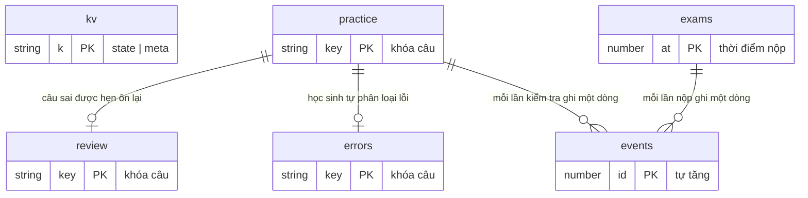

# Mô hình dữ liệu

## 1. Nội dung (chỉ đọc)

Mọi tệp nội dung gán một biến toàn cục `window.KHKT_*`. Thứ tự nạp tệp trong trang quyết định chỉ số của câu hỏi, nên **chỉ thêm tệp mới vào cuối nhóm, không chèn vào giữa**.

### Bài học và bài tập

```text
KHKT_DATA = { 10: [Chương], 11: [Chương], 12: [Chương] }

Chương   { id: "12-I", so: "I", ten, hk, lessons: [Bài học] }
Bài học  { id: "12-I-1", ten, ycc: [chuỗi], kt: [chuỗi], d: Câu, ex: [Câu] }
           ycc: yêu cầu cần đạt     kt: kiến thức cần nhớ
           d: câu chẩn đoán (luôn là trắc nghiệm)     ex: bài tập ôn
```

Một câu hỏi có một trong ba kiểu:

| Kiểu `t` | Trường | Ghi chú |
|---|---|---|
| `mc` trắc nghiệm | `q`, `o` (4 lựa chọn), `a` (chỉ số đáp án), `g` (gợi ý) | Thứ tự lựa chọn được xáo cố định theo khóa câu khi hiển thị |
| `tf` đúng/sai | `q`, `s` (4 cặp `[phát biểu, true/false]`), `g` | Chấm theo thang 0,1 – 0,25 – 0,5 – 1 điểm của Bộ GD&ĐT |
| `sa` trả lời ngắn | `q`, `a` (chuỗi số kiểu Việt Nam, ví dụ `"−2"`, `"3,5"`), `g` | So khớp sau khi chuẩn hóa dấu trừ và dấu phẩy |

Trường tùy chọn: `m` (mức độ: `N` nhận biết, `T` thông hiểu, `V` vận dụng), `tt` và `src` (bài toán thực tế và nguồn gợi ý dạng bài).

Bài tập bổ sung nằm trong `KHKT_EX_ADD = { "<mã bài>": [Câu] }` và được nối vào cuối `ex` của bài học theo thứ tự nạp tệp: `data_them.js` → `thucte.js` → `chuong.js` → `bosung.js`.

### Khóa câu hỏi

Khóa là định danh ổn định của một câu, dùng chung cho lời giải, hình vẽ và dữ liệu người dùng.

| Dạng | Ý nghĩa |
|---|---|
| `12-I-1#d` | Câu chẩn đoán của bài 12-I-1 |
| `12-I-1#3` | Bài tập thứ 4 (chỉ số từ 0) của bài 12-I-1, sau khi nối mọi bài bổ sung |
| `II-2#5` | Câu thứ 6 trong ngân hàng của vị trí câu II-2 trong đề thi |

Vì khóa phụ thuộc chỉ số, **không xóa hay đổi chỗ câu đã phát hành**: làm vậy sẽ gắn nhầm kết quả cũ của học sinh sang câu khác. Muốn bỏ một câu thì thay nội dung tại chỗ.

### Các bảng khác

| Biến | Cấu trúc | Dùng cho |
|---|---|---|
| `KHKT_LG` | `{ "<khóa>": { h, y: [..], b: [..] } }` | Lời giải: hướng đi, ý kiến thức, các bước (bước cuối là đáp án) |
| `KHKT_HINH` | `{ "<khóa>": "<svg…>" }` | Hình minh họa |
| `KHKT_MUC` | `{ "<mã bài>": "NTVVV…" }` | Mức độ của câu chẩn đoán và các bài tập gốc |
| `KHKT_EXAM`, `KHKT_EXAM_ADD`, `KHKT_EXAM_LV` | Vị trí câu `{ id, part, ten, lessons, items }` | Ngân hàng đề thi theo ma trận 22 vị trí |
| `KHKT_SACH` | `{ ctst: { ten, 10: [...], 11: [...], 12: [...] }, cd: {...} }` | Mục lục bộ Chân trời sáng tạo, Cánh diều |
| `KHKT_CT` | `{ cb: [Chương công thức], nc: [Chủ đề nâng cao] }` | Mục Công thức |

```text
Chương công thức  { g: 10|11|12, ch: "<mã chương>", ten, muc: [Mục] }
Chủ đề nâng cao   { ten, muc: [Mục] }
Mục               { ten, ct: [chuỗi công thức], dk?: điều kiện áp dụng, gc?: ghi chú }
```

Toán trong mọi chuỗi là **ký tự Unicode thuần** (`x²`, `√`, `∫`, `−`), không có LaTeX và không có HTML. Giao diện luôn thoát ký tự trước khi chèn vào trang.

## 2. Dữ liệu người dùng

Lưu trong IndexedDB, cơ sở dữ liệu `sotay-toan`, phiên bản lược đồ 1.



| Kho | Khóa chính | Trường | Chỉ mục |
|---|---|---|---|
| `kv` | `k` | `v`: với `k = "state"` là trạng thái chung (bảng dưới); với `k = "meta"` là `{ app, schema, updatedAt }` | |
| `practice` | `key` | `ok` (đúng/sai), `hint` (có xem gợi ý), `at` (thời điểm) | |
| `review` | `key` | `box` (ô ôn lại 0, 1, 2), `due` (hạn ôn) | `due` |
| `errors` | `key` | `t` (loại lỗi 0–3: tính nhầm, sai công thức, hiểu sai đề, chưa biết hướng), `at` | |
| `exams` | `at` | `mode`, `target`, `ch`, `total`, `p1`, `p2`, `p3`, `weak` (chủ đề yếu) | |
| `events` | `id` (tự tăng) | `at`, `type` (`practice`, `exam`, `diagnose`), `key`, `ok`, `hint`, `n`, `score`, `mode` | `at` |

Trạng thái chung (`kv.state`):

| Trường | Kiểu | Ý nghĩa |
|---|---|---|
| `savedAt` | số | Thời điểm ghi, dùng để chọn bản mới hơn giữa IndexedDB và localStorage |
| `grade`, `book` | 11 hoặc 12; `kntt`, `ctst`, `cd` | Lớp và bộ sách đang học |
| `done`, `found` | mảng mã chương; đúng/sai | Chương đã học; có kiểm tra kiến thức nền lớp dưới không |
| `h` | `{ mã câu hỏi: số hoặc mảng số }` | Phiếu thói quen học |
| `ans` | `{ mã bài: chỉ số lựa chọn }` | Bài chẩn đoán đang làm dở |
| `result` | `{ grade, chapters, lessons: { mã bài: đúng/sai }, h, date }` | Kết quả chẩn đoán gần nhất |
| `target` | số | Điểm mục tiêu cho đề thi |
| `exam` | `{ mode, seed, k: [[khóa câu]], ans, submitted, start, score }` | Đề đang làm, để tải lại trang không mất bài |

### Quy tắc ghi

- `kv.state` được ghi lại mỗi lần lưu (nhỏ).
- `practice`, `review`, `errors`, `exams` chỉ ghi các bản ghi **đã thay đổi** so với lần ghi trước; bản ghi không còn trong trạng thái thì bị xóa. Lần ghi đầu của mỗi phiên, hoặc sau một lần ghi lỗi, ghi lại toàn bộ.
- `events` chỉ ghi thêm. Khi vượt 3.000 dòng, 500 dòng cũ nhất bị xóa.
- Song song, một bản chụp đầy đủ được ghi đồng bộ vào `localStorage["khkt-sotay"]`. Khi mở app, bản nào có `savedAt` lớn hơn thì được dùng.

### Làm sạch dữ liệu

Mọi dữ liệu đọc vào đều đi qua `sanitize()` trong `db.js`, kể cả dữ liệu do chính app ghi. Hàm này:

- chỉ giữ các trường đã biết, đúng kiểu, trong khoảng giá trị cho phép;
- chỉ nhận khóa câu khớp `^[A-Za-z0-9-]{1,32}#(d|\d{1,3})$` và mã bài, mã chương khớp `^[A-Za-z0-9-]{1,32}$`;
- loại các khóa `__proto__`, `constructor`, `prototype`;
- giới hạn số phần tử của mỗi bảng.

### Tệp sao lưu

```json
{ "app": "so-tay-hoc-toan", "schema": 2, "exportedAt": "2026-11-16T12:00:00.000Z", "state": { }, "events": [ ] }
```

`schema` là phiên bản định dạng dữ liệu người dùng. Phiên bản 1 là bản chụp localStorage của các bản app cũ và vẫn nhập được. App từ chối tệp có `schema` lớn hơn phiên bản nó hiểu.

### Nâng cấp lược đồ

- Thêm kho hoặc chỉ mục trong IndexedDB: tăng `DB_VER` và thêm một khối `if (ev.oldVersion < n)` trong `onupgradeneeded`. Không sửa các khối cũ.
- Đổi ý nghĩa hoặc tên trường của trạng thái: tăng `SCHEMA`, viết bước chuyển trong `sanitize()` để vẫn đọc được tệp sao lưu cũ, và thêm ca kiểm thử trong `tests/db.test.js`.
